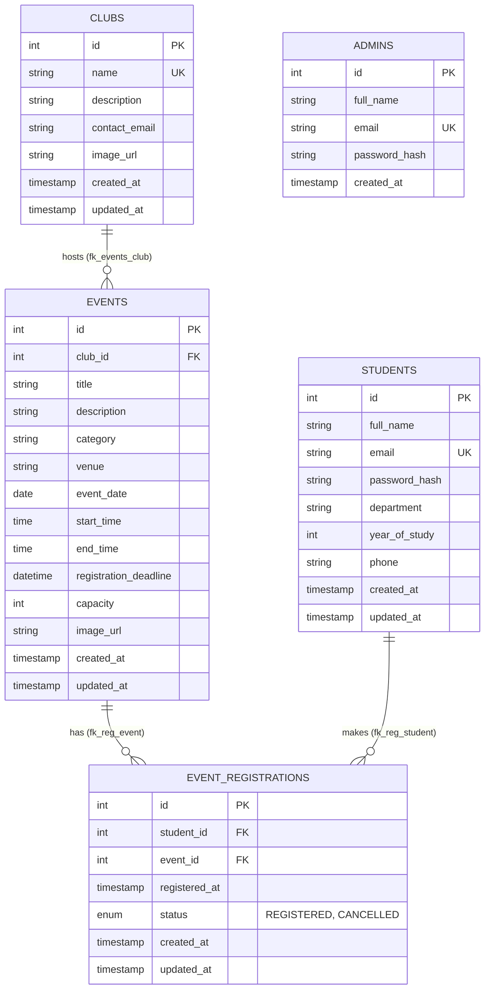

# CampusSphere — College Event Management System

> "Every Event. One Campus. One Platform."

---

## 1. Project Purpose

CampusSphere is a centralized web platform designed for colleges to manage and participate in campus activities. It connects student clubs and event organizers with students, allowing clubs to publish events, track attendee rosters, and manage capacity, while enabling students to discover upcoming activities and reserve seats in real time. The system streamlines campus-wide event coordination without relying on third-party commercial software or heavyweight frameworks.

---

## 2. Features

### Public Features (No Login Required)
- **Home Landing Page (`/` or `/home`)**: Highlights upcoming campus events and featured clubs with real-time participation metrics.
- **Event Catalog (`/events`)**: Search and filter upcoming workshops, hackathons, seminars, sports, and cultural festivals by category and keywords.
- **Event Details (`/events/detail?id=`)**: View schedule, venue, host club details, registration deadline, capacity, and real-time seat availability status (Open, Event Full, Registration Closed, Event Ended).
- **Club Directory & Details (`/clubs`, `/clubs/detail?id=`)**: Browse all registered student societies and view individual club profiles alongside their upcoming events.
- **Health Check Endpoint (`/health`)**: Diagnostic page showing database connection status and application timezone.

### Student Features (Authenticated Session Required)
- **Account Registration (`/register`)**: Self-service registration with validation (full name, student email, department, year of study 1–5, and phone number).
- **Authentication (`/login`, `/logout`)**: Secure login with credential verification and brute-force attempt throttling.
- **Student Dashboard (`/student/dashboard`)**: Personal portal displaying account overview, active event registrations, and past cancellations.
- **Profile Management (`/student/profile`)**: View account details and update department, year of study, and contact phone number.
- **Instant Event Booking (`/student/events/register`)**: Register for open events with real-time capacity checks and ACID transaction guarantees.
- **Self-Service Cancellation (`/student/events/cancel`)**: Cancel active registrations before an event starts with instant confirmation.
- **Re-Registration**: Seamlessly reactivate previously cancelled registrations if seats remain open before the registration deadline.

### Administrator Features (Role-Protected via `/admin/*`)
- **One-Time Bootstrap Setup (`/setup`)**: Initial admin account creation protected by a private setup key and a database guard ensuring it cannot be re-run once an administrator exists.
- **Administrator Login (`/admin/login`)**: Dedicated login portal for system administrators.
- **Dashboard Overview (`/admin/dashboard`)**: Central control panel displaying real-time platform metrics (total clubs, total events, upcoming events, total students, active registrations, cancelled registrations) and the 5 most recent registrations.
- **Club Management (`/admin/clubs`)**: Create new student clubs, edit club profiles, and delete clubs (with deletion blocked if associated events exist).
- **Event Management (`/admin/events`)**: Create, update, and delete campus events, configure venues, set capacities, and define registration deadlines.
- **Event Delete Protection (`/admin/events/delete-confirm`)**: Two-step deletion confirmation displaying affected registration counts.
- **Registration Management (`/admin/registrations`)**: Comprehensive, filterable table of all registrations (filtered by event and/or status) displaying student details, timestamps, and status badges.
- **Printable Attendee Roster (`/admin/events/roster?id=`)**: Dedicated per-event roster listing all confirmed attendees with serial numbers, student names, emails, departments, years of study, and phone numbers, equipped with a clean black-and-white print layout (`window.print()`).

---

## 3. Technology Stack

| Component | Technology | Version / Specification |
| :--- | :--- | :--- |
| **Programming Language** | Java | Java 21 (LTS) |
| **Server-Side API** | Jakarta Servlet | 6.0 (Jakarta EE 10) |
| **View Template Engine** | Jakarta Server Pages (JSP) / JSTL | JSP 3.1 / JSTL 3.0.1 (`jakarta.tags.core`, `jakarta.tags.functions`) |
| **Presentation & UI** | HTML5, CSS3, Vanilla JavaScript | Responsive CSS with custom variables, system fonts, and `@media print` |
| **Relational Database** | MySQL Server | MySQL 8.0+ / 8.4+ (InnoDB engine, `utf8mb4`) |
| **Database Connectivity** | JDBC via `PreparedStatement` | MySQL Connector/J 8.4.0 (try-with-resources per transaction) |
| **Servlet Container** | Apache Tomcat | Tomcat 10.1.x (tested on 10.1.61) |
| **Build & Dependency Tool** | Apache Maven | Maven 3.x producing a standard WAR bundle |
| **Version Control** | Git / GitHub | Feature-branch workflow |

---

## 4. Architecture

CampusSphere follows a classic three-tier Model-View-Controller (MVC) architecture, separating presentation, business orchestration, and data persistence:

1. **Presentation Layer (View)**: Plain JSP templates under `/WEB-INF/views/` rendered exclusively server-side using JSTL tags (`<c:out>`, `<c:forEach>`, `<c:choose>`). All dynamic values are strictly HTML-escaped. Direct access to JSPs is blocked by placing them inside `/WEB-INF/`.
2. **Controller & Business Layer (Controller & Service)**: Jakarta HTTP Servlets intercept incoming requests, validate input through `ValidationUtil`, and invoke business services (`AuthService`, `ClubService`, `EventService`, `RegistrationService`). Services coordinate domain rules, pessimistic locking, timezone evaluation, and transaction boundaries.
3. **Data Access Layer (DAO & Persistence)**: Dedicated DAO classes (`StudentDAO`, `AdminDAO`, `ClubDAO`, `EventDAO`, `RegistrationDAO`) execute parameterized SQL statements using `PreparedStatement` and manage connections via `DBConnection`. No ORMs or hidden abstraction layers are used.

### Package Structure (`com.campussphere.*`)

```text
com.campussphere
├── config
│   └── AppConfig.java                 # Externalized, thread-safe configuration loader
├── dao
│   ├── AdminDAO.java                  # Admin lookup and one-time atomic bootstrap
│   ├── ClubDAO.java                   # Club queries, counts, and CRUD persistence
│   ├── DataAccessException.java       # Standard unchecked DAO exception
│   ├── DuplicateEmailException.java   # Custom exception for MySQL 1062 unique constraint violations
│   ├── EventDAO.java                  # Event search, upcoming count, and CRUD persistence
│   ├── RegistrationDAO.java           # Registration ACID transactions and roster queries
│   └── StudentDAO.java                # Student profile lookup, insertion, and update
├── filter
│   ├── AdminFilter.java               # Guards /admin/* endpoints (requires active ADMIN session)
│   ├── AuthFilter.java                # Guards /student/* endpoints (requires active STUDENT session)
│   ├── CsrfFilter.java                # Validates CSRF tokens on all POST requests
│   └── SecurityHeadersFilter.java     # Applies X-Content-Type-Options, X-Frame-Options, Referrer-Policy
├── model
│   ├── Admin.java                     # Administrator entity model
│   ├── AvailabilityStatus.java        # Enum representing event availability (OPEN, FULL, CLOSED, ENDED)
│   ├── Club.java                      # Student club entity model
│   ├── Event.java                     # Campus event entity model
│   ├── EventRegistration.java         # Event registration entity with joined student/event fields
│   └── Student.java                   # Student account entity model
├── service
│   ├── AuthService.java               # Authentication, registration validation, and setup orchestration
│   ├── ClubService.java               # Club directory management and delete validation
│   ├── EventService.java              # Event lifecycle, status enrichment, and admin management
│   ├── RegistrationResult.java        # Value object holding registration outcome status and message
│   └── RegistrationService.java       # Pessimistic locking registration, cancellation, and roster logic
├── servlet
│   ├── AdminClubCreateServlet.java    # Handles /admin/clubs/new
│   ├── AdminClubDeleteServlet.java    # Handles /admin/clubs/delete-confirm
│   ├── AdminClubEditServlet.java      # Handles /admin/clubs/edit
│   ├── AdminClubListServlet.java      # Handles /admin/clubs
│   ├── AdminDashboardServlet.java     # Handles /admin/dashboard
│   ├── AdminEventCreateServlet.java   # Handles /admin/events/new
│   ├── AdminEventDeleteServlet.java   # Handles /admin/events/delete-confirm
│   ├── AdminEventEditServlet.java     # Handles /admin/events/edit
│   ├── AdminEventListServlet.java     # Handles /admin/events
│   ├── AdminEventRosterServlet.java   # Handles /admin/events/roster
│   ├── AdminLoginServlet.java         # Handles /admin/login
│   ├── AdminRegistrationListServlet.java # Handles /admin/registrations
│   ├── ClubDetailServlet.java         # Handles /clubs/detail
│   ├── ClubListServlet.java           # Handles /clubs
│   ├── EventDetailServlet.java        # Handles /events/detail
│   ├── EventListServlet.java          # Handles /events
│   ├── HealthServlet.java             # Handles /health diagnostic page
│   ├── HomeServlet.java               # Handles / and /home
│   ├── LoginServlet.java              # Handles /login
│   ├── LogoutServlet.java             # Handles /logout
│   ├── ProfileServlet.java            # Handles /student/profile
│   ├── RegisterServlet.java           # Handles /register
│   ├── SetupServlet.java              # Handles /setup one-time bootstrap
│   ├── StudentCancelEventServlet.java # Handles /student/events/cancel
│   ├── StudentDashboardServlet.java   # Handles /student/dashboard
│   └── StudentRegisterEventServlet.java # Handles /student/events/register
└── util
    ├── CsrfUtil.java                  # Generates cryptographically secure CSRF session tokens
    ├── DBConnection.java              # Retrieves JDBC connections from AppConfig credentials
    ├── FlashUtil.java                 # Session-backed single-request flash message utility
    ├── LoginThrottle.java             # In-memory IP and account attempt limiter
    ├── PasswordUtil.java              # PBKDF2WithHmacSHA256 password hashing and constant-time verification
    ├── SessionUtil.java               # Helper for reading user session state and roles
    └── ValidationUtil.java            # Server-side validation rules for entities and form submissions
```

---

## 5. Database Schema & Relationships

The database is built on MySQL 8.4+ InnoDB using UTF-8 Unicode (`utf8mb4`).



### Table Definitions & Constraints
1. **`students`**: Stores registered student accounts.
   - Unique constraint on `email`.
   - Check constraint `chk_year_of_study` ensuring `year_of_study` is between 1 and 5.
2. **`admins`**: Stores administrative credentials.
   - Unique constraint on `email`.
3. **`clubs`**: Stores recognized campus societies and student clubs.
   - Unique constraint on `name`.
4. **`events`**: Stores scheduled activities.
   - Foreign key `club_id` references `clubs(id)` with `ON DELETE RESTRICT` (preventing deletion of a club with active events).
   - Check constraint `chk_capacity` (`capacity IS NULL OR capacity > 0`).
   - Check constraint `chk_event_times` (`end_time > start_time`).
   - Indexes on `event_date`, `club_id`, and `registration_deadline`.
5. **`event_registrations`**: Tracks student event participation.
   - Foreign key `student_id` references `students(id)` with `ON DELETE CASCADE`.
   - Foreign key `event_id` references `events(id)` with `ON DELETE CASCADE`.
   - Unique composite constraint `uq_student_event (student_id, event_id)` preventing duplicate rows.
   - Status managed via `ENUM('REGISTERED', 'CANCELLED')` default `'REGISTERED'`.

---

## 6. Security Implementation

- **Password Hashing**: Implemented in `PasswordUtil` using `PBKDF2WithHmacSHA256` with 600,000 iterations, a 16-byte cryptographically secure random salt, and a 256-bit derived key. Verification uses constant-time comparison (`MessageDigest.isEqual`). A dummy hash calculation is performed for non-existent accounts to eliminate timing side-channels and account enumeration.
- **CSRF Defense**: `CsrfFilter` intercepts every incoming HTTP `POST` request and verifies the `_csrf` token parameter against the token stored in the user's active session. Requests with missing or mismatched tokens are rejected with HTTP 403 Forbidden.
- **Access Control Filters**:
  - `AuthFilter`: Protects all `/student/*` URLs. Unauthenticated users are redirected to `/login`.
  - `AdminFilter`: Protects all `/admin/*` URLs. Unauthorized users are redirected to `/admin/login`, while logged-in students attempting to access admin routes are redirected to `/login` with an error message.
  - Both filters attach `Cache-Control: no-store, no-cache, must-revalidate` and `Pragma: no-cache` headers to prevent browsers from caching sensitive authenticated views.
- **Session & Cookie Security**: Configured in `web.xml` with `<cookie-config><http-only>true</http-only></cookie-config>`, 30-minute session timeout, and `COOKIE` tracking mode to guard against session hijacking and XSS cookie theft.
- **HTTP Security Headers**: `SecurityHeadersFilter` automatically adds `X-Content-Type-Options: nosniff`, `X-Frame-Options: DENY`, and `Referrer-Policy: same-origin` to all HTTP responses.
- **SQL Injection Prevention**: All database queries strictly use JDBC `PreparedStatement` with typed parameter binding (`setInt`, `setString`, `setDate`, etc.). No dynamic SQL string concatenation is permitted.
- **Rate Limiting & Brute-Force Throttling**: `LoginThrottle` maintains an in-memory tracking map keyed by client IP and email. Exceeding 5 failed authentication attempts within 15 minutes triggers a 15-minute temporary lock.
- **Externalized Secrets**: Database passwords and setup keys are never committed to version control. They are resolved at runtime from external environment variables or a configuration file located in the user home directory (`~/.campussphere/campussphere.properties`).

---

## 7. Setup & Deployment Guide

### Prerequisites
- Java Development Kit (JDK) 21 LTS
- Apache Tomcat 10.1.x (Jakarta EE 10 compatible)
- MySQL Server 8.0 or 8.4
- Apache Maven 3.8+
- Git

### Step 1: Database and Application User Setup
1. Copy the setup SQL template into your local working path:
   ```bash
   cp database/00-create-database-and-user.sql.template database/local/00-create-database-and-user.sql
   ```
2. Open `database/local/00-create-database-and-user.sql` in an editor and replace `CHANGE_ME_BEFORE_RUNNING` with a strong password.
3. Log in to MySQL as root and execute the script:
   ```bash
   mysql -u root -p < database/local/00-create-database-and-user.sql
   ```
4. Apply the application schema:
   ```bash
   mysql -u campussphere_app -p campussphere < database/01-schema.sql
   ```
5. *(Optional)* Seed sample data for demonstration:
   ```bash
   mysql -u campussphere_app -p campussphere < database/sample-data.sql
   ```

### Step 2: Configure External Application Properties
1. Create a configuration directory in your user home folder:
   - On Windows: `C:\Users\<YourUsername>\.campussphere\`
   - On Linux/macOS: `~/.campussphere/`
2. Copy the example configuration template to that folder:
   - On Windows:
     ```powershell
     Copy-Item config\campussphere.properties.example "$HOME\.campussphere\campussphere.properties"
     ```
   - On Linux/macOS:
     ```bash
     cp config/campussphere.properties.example ~/.campussphere/campussphere.properties
     ```
3. Open `~/.campussphere/campussphere.properties` and fill in:
   - `db.password`: The application user password configured in Step 1.
   - `setup.key`: A private passphrase used once to initialize the administrator account.

### Step 3: Build the Web Application Archive (WAR)
From the project root, package the application using Maven:
```bash
mvn clean package
```
A successful build will generate `target/campussphere.war`.

### Step 4: Deploy to Apache Tomcat
1. Ensure Apache Tomcat is stopped.
2. Clean existing deployments from Tomcat:
   - Remove `<tomcat-dir>/webapps/campussphere` (folder).
   - Remove `<tomcat-dir>/webapps/campussphere.war` (file).
3. Copy `target/campussphere.war` into `<tomcat-dir>/webapps/`.
4. Start Apache Tomcat:
   - Windows: `<tomcat-dir>\bin\startup.bat`
   - Linux/macOS: `<tomcat-dir>/bin/startup.sh`
5. Open your browser and navigate to:
   ```text
   http://localhost:8080/campussphere/
   ```

### Step 5: Initialize the Administrator Account
1. Navigate to:
   ```text
   http://localhost:8080/campussphere/setup
   ```
2. Enter your full name, administrator email address, master password, and the secret `setup.key` defined in your external configuration file.
3. Submit the form to initialize the primary administrator. Once created, `/setup` is permanently disabled.

---

## 8. Testing Status

### Manually Tested in Browser
- **Admin Setup & Login**: One-time `/setup` initialization with valid setup key; bootstrap form disabled after creation; admin authentication via `/admin/login`.
- **Student Authentication & Profile**: Self-service student registration with validation; login and logout; student profile update (department, year, phone).
- **Access Control & Filters**: Verified that logged-in students and unauthenticated visitors cannot access `/admin/*` routes; verified that unauthenticated visitors cannot access `/student/*` routes.
- **Club Management**: Club creation, validation of duplicate club names, invalid image URL handling, club editing, and event-bound deletion restriction.
- **Event Scheduling**: Event creation with date, time, venue, deadline, and capacity configurations; event update and deletion confirmation.
- **Registration & Cancellation Lifecycle**: Student registration for open events; cancellation of active registrations; re-registration after cancellation.
- **Admin Dashboard & Statistics**: Real-time DB counts for clubs, events, upcoming events, students, active registrations, cancelled registrations, and 5 latest sign-ups.
- **Registrations Directory**: Search and filtering by event and status; 200-row display limit with metadata count.
- **Attendee Roster & Clean Printing**: Verification of active-only attendee lists with serial numbers and contact data; browser print preview (`Ctrl+P`) hiding headers, footers, and buttons with black-on-white CSS.

### NOT Yet Tested
- **Full Capacity Handling**: Event reaching exact maximum capacity and triggering the `FULL` badge / blocking subsequent registrations.
- **Deadline Expiration**: Behavior of the registration button when an event's registration deadline timestamp has passed in the application timezone.
- **Ended Event State**: Availability transition to `ENDED` once an event's end time has passed.
- **Extended Validation Edge Cases**: Additional edge-case inputs on administrator event form submissions.

### Automated Testing
- No automated unit or integration test suite currently exists in the project (`src/test/` is empty). All validations are performed via manual browser flows.

---

## 9. Known Limitations & Future Work

- **No Password Reset**: There is currently no self-service password reset or "Forgot Password" workflow. Account changes require direct administrator intervention.
- **No Payment Gateway**: All campus events are free of charge. Paid ticketing and payment gateway integration are not supported.
- **Public Diagnostic Endpoint**: The `/health` endpoint is publicly visible for local setup verification and should be secured or removed prior to production deployment.
- **Mobile & Accessibility Polish**: While baseline responsive design and WCAG color contrasts are implemented, further mobile screen refinement and screen reader audits remain future work.
- **Sample Seed Data**: The sample test accounts and clubs in `database/sample-data.sql` must be purged before deploying the system for actual institutional use.
- **Email & In-App Notifications (Out of Scope)**: Automatic notifications (e.g., email alerts when a registration is confirmed, when an event is rescheduled, or when a registration is cancelled) are not included in this release. Future phases can integrate Jakarta Mail for SMTP delivery and an `in_app_notifications` table for dashboard alerts.

---

## 10. Project Information

- **Academic Group**: Group No. 10
- **Team members**: AKSA MARIAM NINAN-PTA25CS015
                  : ASWIN S RAJAPPAN-PTA25CS041
                  : N RAMYA-PTA25CS087
                  : SREDHA MANOJ-PTA25CS106
                  : UTHRAJA J-PTA25CS114
