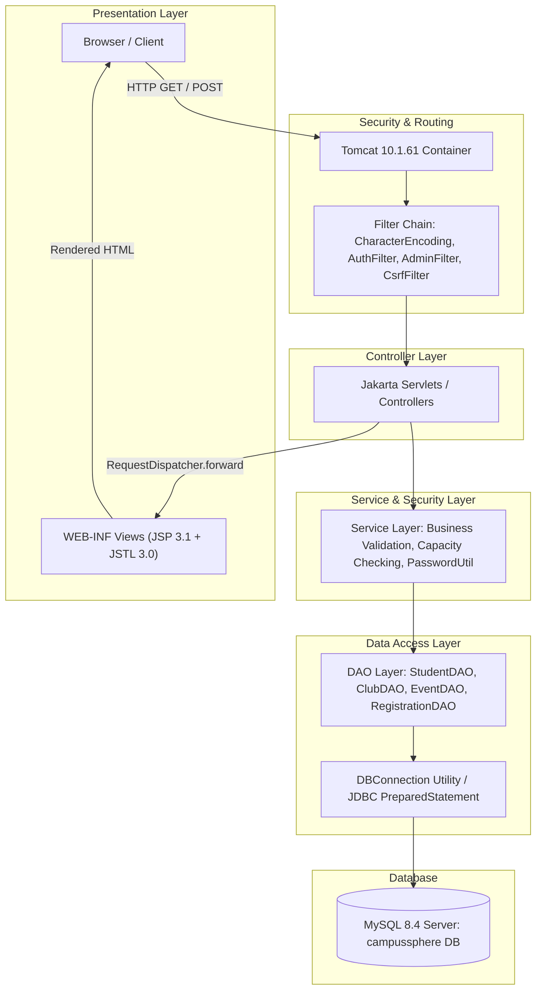

# CampusSphere: Architecture & Project Plan
**College Event Management System**  
*A Java EE 10 / Jakarta Servlet 6.0 Web Application*

---

## 1. Executive Summary & Approved Technology Stack

CampusSphere is a centralized, role-based College Event Management System designed to streamline how campus clubs publish events and how students discover and register for them.

### Approved Stack & Verified Environment
* **Platform & Language:** Java 21 LTS (`jdk-21.0.12`), compiled with source/target release 21.
* **Build System:** Apache Maven 3.9.16 (WAR packaging).
* **Web Container:** Apache Tomcat 10.1.61 (Standalone, local folder `C:\Users\Sreddha\tools\apache-tomcat-10.1.61`).
* **Specifications:** Jakarta EE 10 Core Profile — **Jakarta Servlet 6.0**, **Jakarta Server Pages (JSP) 3.1**, **Jakarta Expression Language (EL) 5.0**, **Jakarta JSTL 3.0**.
* **Database:** MySQL Community Server 8.4.13 running as service `MySQL84` on port `3306`.
* **Database Connectivity:** Direct JDBC via `com.mysql:mysql-connector-j:8.4.0` using `PreparedStatement` exclusively.
* **Frontend:** Clean semantic HTML5, custom responsive CSS3 (no frameworks/Tailwind), and vanilla JavaScript for DOM interactions.
* **Architecture:** Traditional 3-Tier MVC Architecture (Presentation $\rightarrow$ Business Logic $\rightarrow$ Data Access).
* **Strict Constraints:** Zero external heavyweight frameworks (no Spring Boot, Hibernate, Node.js, React, or Python). No cloud storage or third-party email/payment gateways.

---

## 2. Architecture & Design Principles



### 2.1 Three-Tier Layering
1. **Presentation Layer (`/WEB-INF/views/`):**
   * JSP files are strictly placed under `WEB-INF/views/` to prevent direct client browser access (`http://localhost:8080/campussphere/view.jsp` returns 404). Access is permitted **only** via a servlet forwarding the request (`request.getRequestDispatcher(...).forward(request, response)`).
   * Reusable UI components (Navbar, Header, Footer, Flash Alerts) are modularized in `/WEB-INF/views/common/` and included using `<jsp:include page="..." />`.
   * Public static assets (CSS, JS, SVG icons) are located in the `/assets/` directory (`/assets/css/`, `/assets/js/`).
2. **Business Logic & Controller Layer (`com.campussphere.servlet`, `com.campussphere.service`):**
   * **Servlets:** Act as controllers. They inspect incoming HTTP methods (GET/POST), parse and validate request parameters, manage session state, invoke services, bind attributes to the request, and route to views (PRG: Post-Redirect-Get pattern is enforced for form submissions).
   * **Services:** Encapsulate business rules (e.g., verifying registration deadlines, calculating available capacity, validating phone/email formats, coordinating atomic transactions).
   * **Filters (`com.campussphere.filter`):** Intercept requests before servlets to enforce authentication, role permissions, and CSRF token verification.
3. **Data Access Layer (`com.campussphere.dao`, `com.campussphere.model`):**
   * **DAOs:** Encapsulate all SQL queries. Every query utilizes `PreparedStatement` with parameterized placeholders (`?`) to completely eliminate SQL injection.
   * **Models:** Plain Old Java Objects (POJOs) matching database entities with private fields, standard getters/setters, and constructors.

### 2.2 Package Structure
```text
com.campussphere
├── config        -> Configuration loaders (AppConfig, DBConfig)
├── dao           -> Data Access Objects (StudentDAO, AdminDAO, ClubDAO, EventDAO, RegistrationDAO)
├── filter        -> Security and routing filters (AuthFilter, AdminFilter, CsrfFilter)
├── model         -> POJO Entity models (Student, Admin, Club, Event, Registration)
├── service       -> Business logic & orchestration (AuthService, EventService, RegistrationService)
├── servlet       -> Controllers (HomeServlet, AuthServlet, EventServlet, AdminServlet, SetupServlet)
└── util          -> Utilities (DBConnection, PasswordUtil, CsrfTokenUtil, ValidationUtil)
```

### 2.3 Dependencies & Justifications (Maven `pom.xml`)
The dependencies are strictly limited to runtime necessities:
1. `jakarta.servlet:jakarta.servlet-api:6.0.0` (Scope: `provided`): Provided by Tomcat 10.1 runtime.
2. `jakarta.servlet.jsp.jstl:jakarta.servlet.jsp.jstl-api:3.0.0` (Scope: `compile`): Standard tag library API for Jakarta EE 10.
3. `org.glassfish.web:jakarta.servlet.jsp.jstl:3.0.1` (Scope: `runtime`): Reference implementation of JSTL 3.0 compatible with Tomcat 10.1.
4. `com.mysql:mysql-connector-j:8.4.0` (Scope: `runtime`): Official Type-4 JDBC driver for MySQL 8.4.
*All other functionality (cryptography, hashing, regex validation, date/time manipulation, file I/O) is provided natively by standard JDK 21.*

### 2.4 Database Connection Design
* A singleton-style utility `DBConnection` loads connection parameters from `db.properties` located in `src/main/resources`.
* For continuous deployment or external environments, `DBConnection` checks for environment variable overrides (`DB_URL`, `DB_USER`, `DB_PASSWORD`).
* A template `db.properties.example` is committed to the repository. The real `db.properties` is excluded in `.gitignore`.
* **Connection Management:** For this academic project, `DBConnection.getConnection()` delivers standard JDBC connections wrapped in Java's `try-with-resources` statements:
  ```java
  try (Connection conn = DBConnection.getConnection();
       PreparedStatement stmt = conn.prepareStatement(sql)) {
      // Execute query
  }
  ```
  This guarantees that connections, prepared statements, and result sets are deterministically closed even during exceptions, preventing resource and connection leaks without the configuration overhead of JNDI connection pools.

### 2.5 Security Design
* **Password Hashing:** PBKDF2 with HMAC-SHA256 (`PBKDF2WithHmacSHA256`), standard in `javax.crypto` (JDK 21). Each password uses a unique 16-byte cryptographically secure salt (`SecureRandom`) with 65,536 iterations. Stored format: `iterations:saltHex:hashHex`. Plaintext passwords are never stored or logged.
* **Session Management:**
  * To prevent Session Fixation attacks, upon successful login the old session is invalidated (`session.invalidate()`) and a fresh session is created (`request.getSession(true)`).
  * Safe attributes stored: `userId`, `userName`, `userRole` (`STUDENT` or `ADMIN`), and `csrfToken`.
  * On logout, the session is invalidated and session cookies are cleared.
* **Access Control:**
  * `AuthFilter` intercepts `/student/*` and redirects unauthenticated users to `/login?redirect=...`.
  * `AdminFilter` intercepts `/admin/*` and returns HTTP 403 Forbidden or redirects unauthenticated visitors to `/admin/login`.
* **CSRF Protection:**
  * `CsrfTokenUtil` generates a cryptographically random token saved in the user's session.
  * Every POST form includes `<input type="hidden" name="csrf_token" value="${sessionScope.csrfToken}">`.
  * Servlets verify that the submitted token matches the session token before processing write operations.
* **XSS & Output Sanitization:**
  * In JSPs, output is escaped using `<c:out value="${event.title}" />` or `fn:escapeXml(...)`. Raw expression tags (`<%= %>`) and unescaped `${...}` are avoided for user inputs.
* **One-Time Admin Setup Bootstrap:**
  * Initial administrator registration is provided via a dedicated bootstrap endpoint `/setup`.
  * **Security Rule:** This endpoint is functional **only** when `SELECT COUNT(*) FROM admins` is equal to 0 **and** the user inputs a valid setup key configured in `db.properties` or environment variable `CAMPUSSPHERE_SETUP_KEY`.
  * Once the first admin record is inserted, `/setup` permanently locks itself and returns HTTP 404 or redirects to login. Public registration of admin accounts is strictly prohibited.

---

## 3. Database Schema & Concurrency Design

### 3.1 Entity Relationship Diagram (ERD)

```text
+-------------------+       1:N       +-------------------+
|       CLUBS       |----------------<|      EVENTS       |
|-------------------|                 |-------------------|
| id (PK)           |                 | id (PK)           |
| name (UNIQUE)     |                 | club_id (FK)      |
| description       |                 | title, venue      |
| contact_email     |                 | event_date, times |
| image_url         |                 | deadline          |
+-------------------+                 | capacity (NULL=un)|
                                      +-------------------+
                                                | 1
                                                |
                                                | 1:N
                                                v
+-------------------+       1:N       +-----------------------+
|     STUDENTS      |----------------<|  EVENT_REGISTRATIONS  |
|-------------------|                 |-----------------------|
| id (PK)           |                 | id (PK)               |
| full_name         |                 | student_id (FK)       |
| email (UNIQUE)    |                 | event_id (FK)         |
| password_hash     |                 | registered_at         |
| department, year  |                 | status (REG/CANCEL)   |
| phone             |                 | UNIQUE(student, event)|
+-------------------+                 +-----------------------+

+-------------------+
|      ADMINS       |
|-------------------|
| id (PK)           |
| full_name         |
| email (UNIQUE)    |
| password_hash     |
+-------------------+
```

### 3.2 SQL Schema DDL Script
```sql
-- =============================================================================
-- CampusSphere: College Event Management System Database Schema
-- Target Engine: MySQL 8.4+ (InnoDB, utf8mb4)
-- =============================================================================

CREATE DATABASE IF NOT EXISTS campussphere
    CHARACTER SET utf8mb4
    COLLATE utf8mb4_unicode_ci;

USE campussphere;

-- -----------------------------------------------------------------------------
-- 1. Students Table
-- -----------------------------------------------------------------------------
CREATE TABLE IF NOT EXISTS students (
    id INT AUTO_INCREMENT PRIMARY KEY,
    full_name VARCHAR(100) NOT NULL,
    email VARCHAR(150) NOT NULL UNIQUE,
    password_hash VARCHAR(255) NOT NULL,
    department VARCHAR(100) NOT NULL,
    year_of_study TINYINT NOT NULL,
    phone VARCHAR(20) NOT NULL,
    created_at TIMESTAMP DEFAULT CURRENT_TIMESTAMP,
    updated_at TIMESTAMP DEFAULT CURRENT_TIMESTAMP ON UPDATE CURRENT_TIMESTAMP,
    CONSTRAINT chk_year_of_study CHECK (year_of_study BETWEEN 1 AND 5)
) ENGINE=InnoDB DEFAULT CHARSET=utf8mb4 COLLATE=utf8mb4_unicode_ci;

-- -----------------------------------------------------------------------------
-- 2. Admins Table (Bootstrap via /setup)
-- -----------------------------------------------------------------------------
CREATE TABLE IF NOT EXISTS admins (
    id INT AUTO_INCREMENT PRIMARY KEY,
    full_name VARCHAR(100) NOT NULL,
    email VARCHAR(150) NOT NULL UNIQUE,
    password_hash VARCHAR(255) NOT NULL,
    created_at TIMESTAMP DEFAULT CURRENT_TIMESTAMP
) ENGINE=InnoDB DEFAULT CHARSET=utf8mb4 COLLATE=utf8mb4_unicode_ci;

-- -----------------------------------------------------------------------------
-- 3. Clubs Table
-- -----------------------------------------------------------------------------
CREATE TABLE IF NOT EXISTS clubs (
    id INT AUTO_INCREMENT PRIMARY KEY,
    name VARCHAR(100) NOT NULL UNIQUE,
    description TEXT NOT NULL,
    contact_email VARCHAR(150) NOT NULL,
    image_url VARCHAR(255) NULL,
    created_at TIMESTAMP DEFAULT CURRENT_TIMESTAMP,
    updated_at TIMESTAMP DEFAULT CURRENT_TIMESTAMP ON UPDATE CURRENT_TIMESTAMP
) ENGINE=InnoDB DEFAULT CHARSET=utf8mb4 COLLATE=utf8mb4_unicode_ci;

-- -----------------------------------------------------------------------------
-- 4. Events Table
-- -----------------------------------------------------------------------------
CREATE TABLE IF NOT EXISTS events (
    id INT AUTO_INCREMENT PRIMARY KEY,
    club_id INT NOT NULL,
    title VARCHAR(150) NOT NULL,
    description TEXT NOT NULL,
    category VARCHAR(50) NOT NULL,
    venue VARCHAR(150) NOT NULL,
    event_date DATE NOT NULL,
    start_time TIME NOT NULL,
    end_time TIME NOT NULL,
    registration_deadline DATETIME NOT NULL,
    capacity INT NULL, -- NULL represents unlimited capacity
    image_url VARCHAR(255) NULL,
    created_at TIMESTAMP DEFAULT CURRENT_TIMESTAMP,
    updated_at TIMESTAMP DEFAULT CURRENT_TIMESTAMP ON UPDATE CURRENT_TIMESTAMP,
    CONSTRAINT fk_events_club FOREIGN KEY (club_id) 
        REFERENCES clubs(id) ON DELETE RESTRICT,
    CONSTRAINT chk_capacity CHECK (capacity IS NULL OR capacity > 0),
    CONSTRAINT chk_event_times CHECK (end_time > start_time)
) ENGINE=InnoDB DEFAULT CHARSET=utf8mb4 COLLATE=utf8mb4_unicode_ci;

CREATE INDEX idx_events_date ON events(event_date);
CREATE INDEX idx_events_club ON events(club_id);
CREATE INDEX idx_events_deadline ON events(registration_deadline);

-- -----------------------------------------------------------------------------
-- 5. Event Registrations Table
-- -----------------------------------------------------------------------------
CREATE TABLE IF NOT EXISTS event_registrations (
    id INT AUTO_INCREMENT PRIMARY KEY,
    student_id INT NOT NULL,
    event_id INT NOT NULL,
    registered_at TIMESTAMP DEFAULT CURRENT_TIMESTAMP,
    status ENUM('REGISTERED', 'CANCELLED') NOT NULL DEFAULT 'REGISTERED',
    created_at TIMESTAMP DEFAULT CURRENT_TIMESTAMP,
    updated_at TIMESTAMP DEFAULT CURRENT_TIMESTAMP ON UPDATE CURRENT_TIMESTAMP,
    CONSTRAINT fk_reg_student FOREIGN KEY (student_id) 
        REFERENCES students(id) ON DELETE CASCADE,
    CONSTRAINT fk_reg_event FOREIGN KEY (event_id) 
        REFERENCES events(id) ON DELETE CASCADE,
    CONSTRAINT uq_student_event UNIQUE (student_id, event_id)
) ENGINE=InnoDB DEFAULT CHARSET=utf8mb4 COLLATE=utf8mb4_unicode_ci;

CREATE INDEX idx_reg_student ON event_registrations(student_id);
CREATE INDEX idx_reg_event ON event_registrations(event_id);
CREATE INDEX idx_reg_status ON event_registrations(status);
```

### 3.3 Concurrency & Capacity Enforcement
A common pitfall in event management software is overbooking when multiple students attempt to register simultaneously for the final seat. CampusSphere solves this cleanly using standard ACID transactions and pessimistic locking:

1. **Transaction Initialization:** The `RegistrationService` disables autocommit:
   ```java
   conn.setAutoCommit(false);
   ```
2. **Pessimistic Row Lock on Event:** The event details are retrieved with an exclusive lock:
   ```sql
   SELECT id, capacity, registration_deadline, event_date, start_time 
   FROM events 
   WHERE id = ? FOR UPDATE;
   ```
3. **Deadline Verification:** The service verifies that `NOW() <= registration_deadline`.
4. **Active Registration Count:** If `capacity` is not `NULL`, the service counts active attendees:
   ```sql
   SELECT COUNT(*) FROM event_registrations 
   WHERE event_id = ? AND status = 'REGISTERED' FOR UPDATE;
   ```
5. **Capacity Guard:** If `activeCount >= capacity`, the transaction issues a rollback and throws an `EventFullException` notifying the user that the event is at maximum capacity.
6. **Idempotent Registration / Re-registration:**
   The `UNIQUE KEY (student_id, event_id)` prevents multiple active rows. If a student previously registered and cancelled, re-registering executes an update:
   ```sql
   INSERT INTO event_registrations (student_id, event_id, status, registered_at)
   VALUES (?, ?, 'REGISTERED', CURRENT_TIMESTAMP)
   ON DUPLICATE KEY UPDATE status = 'REGISTERED', registered_at = CURRENT_TIMESTAMP;
   ```
7. **Commit & Cleanup:** The transaction is committed with `conn.commit()`. On any failure, `conn.rollback()` is executed inside the `catch` block.

### 3.4 Dedicated Application User Setup
To respect least-privilege security principles, the web app should not connect as MySQL `root`. The administrator executes:
```sql
CREATE DATABASE IF NOT EXISTS campussphere CHARACTER SET utf8mb4 COLLATE utf8mb4_unicode_ci;
CREATE USER IF NOT EXISTS 'campussphere_app'@'localhost' IDENTIFIED BY 'REPLACE_WITH_YOUR_DB_PASSWORD';
GRANT SELECT, INSERT, UPDATE, DELETE ON campussphere.* TO 'campussphere_app'@'localhost';
FLUSH PRIVILEGES;
```

---

## 4. Complete Application Route Map

| URL Pattern | HTTP Method | Servlet / Handler | JSP View / Action | Role Required | Description |
| :--- | :---: | :--- | :--- | :---: | :--- |
| `/` or `/home` | GET | `HomeServlet` | `/WEB-INF/views/public/home.jsp` | Public | Hero banner, upcoming featured events, clubs spotlight |
| `/events` | GET | `EventListServlet` | `/WEB-INF/views/public/events.jsp` | Public | Searchable, filterable event catalog (category, date) |
| `/events/detail` | GET | `EventDetailServlet` | `/WEB-INF/views/public/event-detail.jsp` | Public | Complete event info, venue, deadline, live seat badge |
| `/clubs` | GET | `ClubListServlet` | `/WEB-INF/views/public/clubs.jsp` | Public | Directory of active student clubs |
| `/clubs/detail` | GET | `ClubDetailServlet` | `/WEB-INF/views/public/club-detail.jsp` | Public | Club profile, contact info, organized events |
| `/register` | GET | `AuthServlet` | `/WEB-INF/views/auth/register.jsp` | Public | Student registration form |
| `/register` | POST | `AuthServlet` | Redirect $\rightarrow$ `/login` or `/register` | Public | Handles student account creation |
| `/login` | GET | `AuthServlet` | `/WEB-INF/views/auth/login.jsp` | Public | Student login form |
| `/login` | POST | `AuthServlet` | Redirect $\rightarrow$ `/student/dashboard` | Public | Authenticates student, regenerates session |
| `/logout` | POST | `LogoutServlet` | Redirect $\rightarrow$ `/login?msg=logged_out` | Any | Invalidates session, removes session cookie |
| `/setup` | GET | `SetupServlet` | `/WEB-INF/views/auth/setup.jsp` | Public (Guarded) | One-time bootstrap for first admin |
| `/setup` | POST | `SetupServlet` | Redirect $\rightarrow$ `/admin/login` | Public (Guarded) | Validates setup key & creates initial admin |
| `/admin/login` | GET | `AdminAuthServlet` | `/WEB-INF/views/auth/admin-login.jsp` | Public | Admin login portal |
| `/admin/login` | POST | `AdminAuthServlet` | Redirect $\rightarrow$ `/admin/dashboard` | Public | Authenticates admin credentials |
| `/student/dashboard` | GET | `StudentDashboardServlet` | `/WEB-INF/views/student/dashboard.jsp` | Student | Summary of enrolled events, announcements |
| `/student/events/register` | POST | `RegistrationServlet` | Redirect $\rightarrow$ `/student/registrations` | Student | Atomically registers for an event with CSRF check |
| `/student/events/cancel` | POST | `RegistrationServlet` | Redirect $\rightarrow$ `/student/registrations` | Student | Cancels existing registration |
| `/student/registrations` | GET | `StudentRegistrationServlet`| `/WEB-INF/views/student/registrations.jsp` | Student | Table of registered & past events with status tags |
| `/student/profile` | GET | `ProfileServlet` | `/WEB-INF/views/student/profile.jsp` | Student | Displays student details & department info |
| `/student/profile` | POST | `ProfileServlet` | Redirect $\rightarrow$ `/student/profile` | Student | Updates student contact details |
| `/admin/dashboard` | GET | `AdminDashboardServlet` | `/WEB-INF/views/admin/dashboard.jsp` | Admin | Overall metrics (total students, events, registrations) |
| `/admin/events` | GET | `AdminEventServlet` | `/WEB-INF/views/admin/events-manage.jsp` | Admin | Table of all events with action buttons |
| `/admin/events/create` | GET | `AdminEventServlet` | `/WEB-INF/views/admin/event-form.jsp` | Admin | Form to create a new event |
| `/admin/events/create` | POST | `AdminEventServlet` | Redirect $\rightarrow$ `/admin/events` | Admin | Validates and saves new event |
| `/admin/events/edit` | GET | `AdminEventServlet` | `/WEB-INF/views/admin/event-form.jsp` | Admin | Edit existing event |
| `/admin/events/edit` | POST | `AdminEventServlet` | Redirect $\rightarrow$ `/admin/events` | Admin | Updates event details |
| `/admin/events/delete` | POST | `AdminEventServlet` | Redirect $\rightarrow$ `/admin/events` | Admin | Removes event (with safety validation) |
| `/admin/events/attendees`| GET | `AdminAttendeeServlet` | `/WEB-INF/views/admin/event-attendees.jsp`| Admin | Attendee roster for an event (export/print view) |
| `/admin/clubs` | GET | `AdminClubServlet` | `/WEB-INF/views/admin/clubs-manage.jsp` | Admin | Club listing and management |
| `/admin/clubs/create` | GET/POST | `AdminClubServlet` | `/WEB-INF/views/admin/club-form.jsp` | Admin | Create new student club |
| `/admin/clubs/edit` | GET/POST | `AdminClubServlet` | `/WEB-INF/views/admin/club-form.jsp` | Admin | Edit student club profile |

---

## 5. UI/UX Design System

To ensure an impressive visual presentation without heavy UI libraries, CampusSphere employs a tailored modern CSS design system.

### 5.1 Color Palette
* **Primary / Brand:**
  * `#2563eb` (Royal Blue - Main Buttons, Brand Highlights)
  * `#1d4ed8` (Darker Blue - Hover states)
  * `#1e3a8a` (Navy - Sidebar & Main Headings)
* **Secondary / Accent:**
  * `#f59e0b` (Warm Amber - Badges: "Filling Fast", Deadlines)
  * `#0d9488` (Teal - Club Highlights)
* **Neutral Backgrounds & Surfaces:**
  * `#f8fafc` (Slate 50 - Page Background)
  * `#ffffff` (White - Card & Table Surfaces)
  * `#e2e8f0` (Slate 200 - Borders, Dividers)
* **Typography Colors:**
  * `#0f172a` (Slate 900 - Primary Headings, Contrast Ratio 14.5:1 against white)
  * `#334155` (Slate 700 - Body text, Contrast Ratio 8.2:1 against white)
  * `#64748b` (Slate 500 - Subtitles & Timestamps)
* **Feedback States:**
  * Success: `#10b981` (Green background `#ecfdf5`)
  * Warning: `#f59e0b` (Amber background `#fffbeb`)
  * Danger: `#ef4444` (Red background `#fef2f2`)
  * Info: `#0284c7` (Sky blue background `#f0f9ff`)

### 5.2 Typography
* Zero external web fonts (Google Fonts) required; eliminates render-blocking network calls.
* **Font Family:** `system-ui, -apple-system, BlinkMacSystemFont, 'Segoe UI', Roboto, Helvetica, Arial, sans-serif`
* **Monospace Family (for dates, IDs):** `'Cascadia Code', Consolas, 'Segoe UI Mono', monospace`
* **Type Hierarchy:**
  * `h1`: 2rem (32px), bold, tracking tight.
  * `h2`: 1.5rem (24px), semi-bold.
  * `h3`: 1.25rem (20px), semi-bold.
  * Body: 0.95rem (15.2px), line-height 1.6.
  * Small: 0.8rem (12.8px), muted.

### 5.3 Components Design
* **Event Cards:** Rounded corners (`12px`), subtle box shadow (`0 4px 6px -1px rgba(0,0,0,0.08)`), hover elevation transition (`transform: translateY(-3px)`), category pill, date badge, and live seat indicator.
* **Forms:** Vertical stack, clear labels, mandatory field asterisks (`*`), distinct focus outlines (`box-shadow: 0 0 0 3px rgba(37, 99, 235, 0.2)`), server-side error banners.
* **Tables:** Zebra-striped rows, sticky headers for long attendee lists, responsive overflow wrappers (`overflow-x: auto`), and pill-shaped status badges.
* **Flash Message Alerts:** Slide-down alerts for `success`, `error`, and `info` with icons and a close trigger.
* **Empty States:** SVG illustration placeholder, encouraging explanation (e.g., *"No upcoming events found in this category"*), and an action button to reset filters.

---

## 6. Implementation Phase Plan (Phases 3 to 10)

| Phase | Title | Primary Files Expected | Key Acceptance Criteria | Verification Method |
| :---: | :--- | :--- | :--- | :--- |
| **3** | **Maven Foundation & Database Configuration** | `pom.xml`, `.gitignore`, `db.properties.example`, `DBConnection.java`, `schema.sql` | `mvn clean package` produces a valid `.war`. `DBConnection` successfully reads properties without hardcoded credentials. | Run `mvn compile` and test JDBC connectivity utility. |
| **4** | **Public Layout & Exploration Views** | `header.jsp`, `footer.jsp`, `navbar.jsp`, `style.css`, `HomeServlet`, `EventListServlet`, `events.jsp`, `event-detail.jsp`, `clubs.jsp` | Browsing `/`, `/events`, and `/clubs` renders responsive HTML layout. Event search and category filters function correctly. | Deploy WAR to Tomcat; navigate via web browser across desktop and mobile viewports. |
| **5** | **Authentication & Role-Based Access Control** | `Student.java`, `Admin.java`, `PasswordUtil.java`, `AuthServlet.java`, `AuthFilter.java`, `AdminFilter.java`, `SetupServlet.java`, `login.jsp`, `register.jsp` | Password hashing uses PBKDF2 with salt. Protected URLs (`/student/*`, `/admin/*`) deny unauthenticated visitors. `/setup` creates initial admin and locks itself. | Register student; test login; verify password hash format in MySQL table; attempt direct access to `/admin/dashboard`. |
| **6** | **Club & Event Management (Admin CRUD)** | `ClubDAO.java`, `EventDAO.java`, `AdminEventServlet.java`, `AdminClubServlet.java`, `event-form.jsp`, `events-manage.jsp` | Admin can create, edit, and view clubs and events. Event validation enforces `end_time > start_time` and `deadline <= event_date`. | Admin creates a club and event; verify database persistence; test validation with invalid deadlines. |
| **7** | **Student Event Registration & History** | `RegistrationDAO.java`, `RegistrationService.java`, `RegistrationServlet.java`, `registrations.jsp`, `dashboard.jsp` | Students can register for events. Capacity is enforced with transaction locks. Duplicate registrations blocked. Cancellations update status to `CANCELLED`. | Register with demo student; verify seat count decrement; attempt registration on full event; verify cancellation. |
| **8** | **Admin Dashboard & Attendee Management** | `AdminDashboardServlet.java`, `AdminAttendeeServlet.java`, `dashboard.jsp`, `event-attendees.jsp` | Metrics (total students, active events, seats filled) compute accurately. Admin can view and print student attendee rosters. | Inspect dashboard counts against SQL queries; open attendee list for an event with registered students. |
| **9** | **UI/UX Polish, Accessibility & Error Pages** | `404.jsp`, `500.jsp`, `web.xml`, CSS refinement for contrast & mobile layout | Graceful error handling (no stack traces displayed). Full keyboard navigation and WCAG AA contrast compliance. | Request non-existent route `/invalid`; trigger test 500 error; verify custom friendly error view renders. |
| **10** | **End-to-End Testing & Project Documentation** | `README.md`, `DEPLOYMENT.md`, `sample-data.sql` | Clean build from source. Sample database populates clubs, events (open, full, past), and demo students. End-to-end smoke test passes. | Follow `README.md` instructions from scratch on a clean test run; confirm full project workflow. |

---

## 7. Windows Local Development & Tomcat Deployment Workflow

```text
[Source Code: C:\Users\Sreddha\CampusSphere]
                 │
                 ▼ (mvn clean package)
[Artifact: target/campussphere.war]
                 │
                 ▼ (Copy to webapps/)
[Tomcat: C:\Users\Sreddha\tools\apache-tomcat-10.1.61\webapps\campussphere.war]
                 │
                 ▼ (bin\startup.bat)
[Live Application: http://localhost:8080/campussphere/]
```

### 7.1 Build Instructions
Open PowerShell in `C:\Users\Sreddha\CampusSphere` and run:
```powershell
mvn clean package
```
This compiles all Java classes, verifies resource files, and creates `target\campussphere.war`.

### 7.2 Manual Deployment to Tomcat
Copy the generated WAR file into Tomcat's `webapps` folder:
```powershell
Copy-Item "target\campussphere.war" -Destination "C:\Users\Sreddha\tools\apache-tomcat-10.1.61\webapps\"
```
*Note: Tomcat automatically unpacks `campussphere.war` into a directory named `campussphere`.*

### 7.3 Starting & Stopping Tomcat
* **To Start Tomcat:**
  Run the batch script directly from its directory:
  ```powershell
  & "C:\Users\Sreddha\tools\apache-tomcat-10.1.61\bin\startup.bat"
  ```
  A separate console window will open showing Tomcat's runtime logs.
* **To Access Application:** Open your browser to:
  `http://localhost:8080/campussphere/`
* **To Stop Tomcat:**
  ```powershell
  & "C:\Users\Sreddha\tools\apache-tomcat-10.1.61\bin\shutdown.bat"
  ```

### 7.4 Viewing Server Logs
* Real-time logs appear in the Tomcat popup console window.
* Persistent log files are located at:
  `C:\Users\Sreddha\tools\apache-tomcat-10.1.61\logs\catalina.yyyy-mm-dd.log` and `localhost.yyyy-mm-dd.log`.
* `CATALINA_HOME` environment variable is not required when scripts are executed directly from Tomcat's `bin` folder.

---

## 8. Risks, Mitigations & Questions for User

### 8.1 Identified Risks & Technical Mitigations
1. **JSTL Namespace Incompatibility:**
   * *Risk:* Using old JSTL 1.2 (`http://java.sun.com/jsp/jstl/core`) will cause `ClassNotFoundException` / `NoClassDefFoundError` on Tomcat 10.1 (`javax.servlet` vs `jakarta.servlet`).
   * *Mitigation:* Ensure `pom.xml` uses JSTL 3.0 API & implementation, and all JSP files reference the Jakarta EE namespace:
     ```jsp
     <%@ taglib prefix="c" uri="jakarta.tags.core" %>
     <%@ taglib prefix="fmt" uri="jakarta.tags.fmt" %>
     <%@ taglib prefix="fn" uri="jakarta.tags.functions" %>
     ```
2. **MySQL 8.4 Default Authentication Plugin:**
   * *Risk:* MySQL 8.4 enforces `caching_sha2_password` authentication, which can fail if SSL is not configured or old drivers are used.
   * *Mitigation:* Use `mysql-connector-j` version `8.4.0` with the connection string parameter `allowPublicKeyRetrieval=true&useSSL=false&serverTimezone=UTC` in local development.
3. **Event Capacity Concurrency Race Conditions:**
   * *Risk:* Two students registering simultaneously for the last seat could cause capacity oversubscription.
   * *Mitigation:* Handled via database transactions with `SELECT ... FOR UPDATE` row-level locks and `UNIQUE KEY (student_id, event_id)` constraints.
4. **Timezone Discrepancies:**
   * *Risk:* Differences between database server time, JVM time, and client browser time can lead to premature registration closures.
   * *Mitigation:* Standardize database timestamps on `UTC` or explicit college local timezone (e.g. `Asia/Kolkata`), handling event dates consistently with `java.time.LocalDate` and `java.time.LocalDateTime`.

### 8.2 Questions for the User (Before Phase 3)
1. **Context Path:** Do you prefer the web application deployed at `/campussphere` (`http://localhost:8080/campussphere`) or as the root application `/` (`http://localhost:8080/`)?
2. **College Timezone:** What is the local timezone for event deadlines (e.g., `Asia/Kolkata` for India / IST)?
3. **MySQL Database User:** Do you have root administrative access in MySQL to create the `campussphere` database and execute the user creation script, or do you have an existing database assigned to you?

---

## 9. Decisions and Changes After Phase 2 Review

During the transition from initial planning to Phase 3 implementation, the following architectural refinements were formalized:

1. **External Configuration File Location & Precedence:**
   * Configuration resolution follows a strict hierarchy: System Environment Variables $\rightarrow$ Custom file via `CAMPUSSPHERE_CONFIG` $\rightarrow$ Default external user file `${user.home}/.campussphere/campussphere.properties`.
   * Storing database passwords and setup keys outside the repository guarantees that sensitive credentials cannot be accidentally staged or committed to Git.
2. **Timezone Handling:**
   * Removed `serverTimezone=UTC` from the JDBC connection string to avoid driver/database timezone translation bugs.
   * Business deadline validations will be performed Java-side using `app.timezone` (configured default: `Asia/Kolkata`) with `java.time.ZonedDateTime` and `ZoneId`.
3. **Dedicated Least-Privilege Application User:**
   * Replaced generic root access with a dedicated MySQL user (`campussphere_app`).
   * Privileges are strictly limited to `SELECT, INSERT, UPDATE, DELETE` on `campussphere.*` (no schema modification, table dropping, or user administrative permissions).
4. **Route Map Additions:**
   * Added `/admin/clubs/delete` (POST with confirmation guard) to manage club deprecation.
   * Added `/admin/registrations` (GET) in Phase 8 to provide an institution-wide global registration overview across all clubs and events.
5. **Phase Realignment (Phases 4 & 8):**
   * Moved `sample-data.sql` and read-only versions of `EventDAO` and `ClubDAO` into Phase 4 to enable immediate visual testing with realistic event cards on the public homepage.
   * Standardized attendee rosters as printable/clean web layouts (no extra CSV export libraries required).
6. **Registration Re-activation Logic:**
   * When a student re-registers for an event they previously cancelled:
     1. The transaction locks the target event row with `SELECT ... FOR UPDATE`.
     2. It inspects existing registration records for `(student_id, event_id)`.
     3. If status is `REGISTERED`, the transaction rejects the duplicate registration.
     4. If status is `CANCELLED`, the service re-verifies that the event deadline has not passed and that capacity is available before atomically updating status back to `REGISTERED`.
7. **Database Index Optimization:**
   * Removed the redundant `idx_reg_student` on `event_registrations(student_id)` because MySQL automatically utilizes the composite `UNIQUE KEY uq_student_event (student_id, event_id)` for queries filtered on `student_id`.
8. **Local Development Connection Security Notice:**
   * The JDBC parameters `useSSL=false` and `allowPublicKeyRetrieval=true` are explicitly documented as local-development conveniences only (for local environments without configured TLS certificates).

